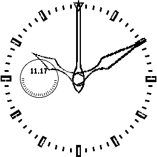
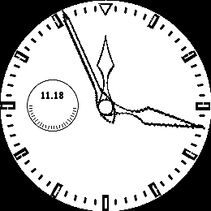
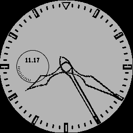
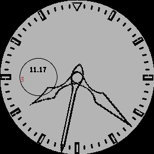
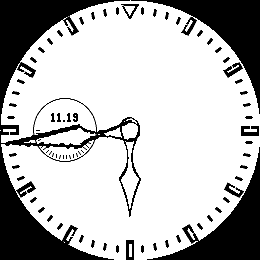
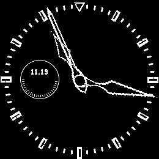
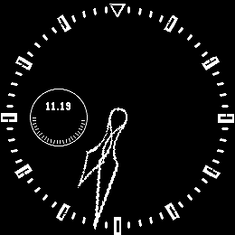

# London Whispers

A Pebble Alloy watchface — Uses PDC files to draw elements on the screen. Watchface rendering is done commpletely using Poco render. Currently watchface is black and white, but in the future I'll modify the PDC files so it can be rendered in other color schemes.

<table>
    <tr>
        <td>
            </img>
        </td>
        <td>
            </img>
        </td>
        <td>
            </img>
        </td>
        <td>
            </img>
        </td>
    </tr>
</table>

## Customization
Due to memory constraints, I could not get integration with pebble clay, however you can choose if this wactface should render the seconds hand by modifying the RENDER_SECONDS_HAND variable to true.

```bash
localStorage.setItem('RENDER_SECONDS_HAND', 'true')
```

## Releases
Links to different releases of this watchface on the pebble app store.
<table>
    <tr>
        <th>Version</th>
        <th>Description</th>
        <th>Screenshot</th>
        <th>Release Link</th>
    </tr>
    <tr>
        <th>Light</th>
        <td>Light mode - Includes rendering of seconds hand</td>
        <td>
            </img>
        </td>
        <td>
            <a href="https://apps.repebble.com/719f89e81202454c85faa59a">[LINK]</a>
        </td>
    </tr>
    <tr>
        <td>Light - No seconds</td>
        <td>Light mode - Doesn't render seconds hand. Screen redraws on minute change so it may save on some battery.</td>
        <td>
            </img>
        </td>
        <td>
            <a href="https://apps.repebble.com/ee7cd10488fd46b5ac5512aa">[LINK]</a>
        </td>
    </tr>
    <tr>
        <th>Dark</th>
        <td>Dark mode - Includes rendering of seconds hand</td>
        <td>
            </img>
        </td>
        <td>
            <a href="https://apps.repebble.com/2ea1fdd007354292b44071d6">[LINK]</a>
        </td>
    </tr>
    <tr>
        <th>Dark - No Seconds</th>
        <td>Dark mode - Doesn't render seconds hand. Screen redraws on minute change so it may save on some battery.</td>
        <td>
            </img>
        </td>
        <td>
            <a href="https://apps.repebble.com/eace50bbe9d74030aa2616bc">[LINK]</a>
        </td>
    </tr>
</table>
Updates and future releases will be posted on <a href="https://forum.repebble.com/t/my-first-watchface-london-whispers/1980">[THIS]</a> thread.

## Building & running
```sh
pebble build                          # build for all targetPlatforms
pebble install --emulator gabbro       # install on the gabbro emulator
pebble install --phone <ip>           # install to a paired phone
```

## Target platforms

Watcface has been developed exclusively ro run for **gabbro** (Pebble Round 2). Other platforms are currently not supported.


## Documentation

Full SDK docs and tutorials: <https://developer.repebble.com>
